# GBox（`1.8.4.02`）REA 静态架构分析与 CAGE 方案 B 可行性评估（2026-11-15）

> 说明：本文为基于 `rea-agents@6.5.0` 对本地研究样本 `GBox-1.8.4.02.apk`（位于约定本地目录 `mobile/.build/gbox-test/GBox-1.8.4.02.apk`，不纳入 Git）开展的**只读静态架构分析**与洁净室路线 B（基于 GBox 架构自研开源版 Android CAGE）可行性结论整理。分析过程中未改动仓库源码、桌面三端运行时或用户个人配置目录；不提交任何闭源 APK、私钥、账号、令牌或整包反编译源码转储；未升级应用版本号、创建发布标签或执行发版。

---

## 1. 分析环境与实测能力边界

| 项目 | 本次实际状态 | 版本 / 参数 / 边界说明 |
| :--- | :--- | :--- |
| 主机与工具链 | **Windows x64 已实测** | `rea-agents` `6.5.0`（Node `24.18.0`）、JDK `17.0.12` |
| Android DEX / Manifest / 资源 | **已实测通过** | `jadx-headless-mcp` `0.7.1`（SHA-256 `6e5eacf500b64292bfb73c49797c1958f6ee44646e43e868039ae7feb573ff75`）+ `apktool` `3.0.3`；完成多包类搜索、方法级反编译、Smali 回退与 XREF 追踪 |
| ARM64 Native ELF (`.so`) | **仅头/符号/字符串审计；深度反编译未实测** | 本机未配置 `ghidra`、`ida` 或 `hopper`（`missing_analysis_engine`），且 `rea inspect-binary-layout`（`pwntools-elf`）仅支持 Linux x64；未做原生指令级反编译还原 |
| 实机运行与跨平台范围 | **未执行动态实测** | 本文所有代码行为结论均来源于静态字节码、Manifest、资源及 ELF 导出/导入/字符串审计；未在本轮执行 Android 真机/模拟器动态抓包，未涉及 macOS / Linux 构建验证 |

**工具链调用经验**：`rea.mjs mcp` 会在单次 MCP 会话中缓存已加载 APK 的 `JadxSession`（18,002 个类的宿主 APK 冷加载约 9.18s），通过持久化 MCP 会话批量发送请求可显著降低多类反编译开销。

---

## 2. GBox（`1.8.4.02`）总体包结构与四层协同架构

从宿主 APK 及 `assets/preset_app_versions.json` 还原的组件清单如下：

| 组件 | 包名 / 版本 / `versionCode` | 体量与关键构成 | 核心职责 |
| :--- | :--- | :--- | :--- |
| **宿主与虚拟化引擎**（`GBox-1.8.4.02.apk`） | `com.gbox.android` / `1.8.4.02` (`1080402`) | `18,002` 个 DEX 类；`minSdkVersion=21`、`targetSdkVersion=28`、`sharedUserId="com.gbox.shared"`；含 `1,021` 个 `com.vlite.sdk.*` 类、32/64 位 `libvlitecore` / `libloader` / `assets/libpreload`、HMS 配置（`grs_sdk_*.json`、`hmsrootcas.bks`）及 `com.vmos.gboxtest.utils.MultiApkInstaller` 等模块 | 提供应用层沙盒（AMS/PMS/Account/Permission 虚拟服务）、跨 UID Binder 代理、设备覆写（`DeviceOverrideImpl`）、华为环境检测（`GBoxMarketEnvChecker`）与宿主服务桥接 |
| **定制 microG**（`MG-250952077.apk`） | `com.google.android.gms` / `25.09.52 (092007-789889203)-gbox-0920` (`250952077`) | 内嵌 Huawei Map Kit（arm64 `libmap.so` 9,860,512 B、`libTransform.so` `wgs84togcj02` / `gcj02towgs84`）与 `assets/agconnect-services.json` | Google 账号认证、DroidGuard 运行时（本地 VM + 条件式云端代算分支）、Maps/FIDO/Checkout 兼容与防检测 Shims |
| **Play Integrity 伴侣**（`MGC.apk`） | `com.android.vending.mgc` / `40.2.48-gbox-0708` (`84024869`) | 实现 Play Integrity 与 Express Integrity 服务；含 `com.huawei.signature.diff.SignatureService` 与 `fake-signature` | 校验调用方签名与白名单，获取 Play OAuth2 Token，联动 `MG` DroidGuard 并直连 Google `/fdfe/*` 接口 |
| **原版 Play Store**（`gpstore400013.apk`） | `com.android.vending` / `40.0.13-23 [0] [PR] 612537281` (`84001300`) | `40,550` 个 DEX 类；保留原生 Play Store Manifest | 在虚拟容器内部（或支持 OEM 差分签名的华为宿主模式）提供商店界面与分发下载 |
| **宿主 UX 桥接器**（`gbox-helper.apk`） | `com.gbox.android.helper` / `1.0.23` (`123`) | `3,131` 类（仅 `65` 个非库类），`debuggable="true"` | 宿内外凭据选择（`CredentialSelectorActivity`）、文件选取（`IntentActivity`，`GET_CONTENT`）与浏览器拉起（`BrowserActivity`，`VIEW http/https`），经 `HostApiServiceProvider` 交换双向 AIDL Binder |

```mermaid
flowchart LR
    GuestApp["容器内目标应用"] -->|"GMS / Integrity 请求"| StubService["VLite StubService + com.vlite.sdk.gms.proxy.a..k"]
    StubService -->|"UID/PID CallingIdentity 改写与多层 Binder 包装"| MG["MG-250952077 (com.google.android.gms)"]
    StubService -->|"Play Integrity / Express API"| MGC["MGC.apk (com.android.vending.mgc)"]
    MGC -->|"OAuth2 + DroidGuard 请求"| MG
    MGC -->|"直连 HTTPS POST + LOCK_BOOTLOADER"| FDFE["play-fe.googleapis.com/fdfe/*"]

    MG -->|"minute_maid / 普通流程 或非出境易环境"| LocalDG["EmbeddedDroidGuardHandleImpl + ServiceProxy + Keystore 阻断"]
    LocalDG -->|"拉取标准 DroidGuard VM"| GoogleDG["googleapis.com/androidantiabuse/v1/x/create"]

    MG -->|"Utils.isIgnoringSystem 或 AppEnv.isCjy 且为 vending pia_* 流程"| CloudDG["NetworkDroidGuardHandleImpl (云机方案)"]
    CloudDG -->|"content://com.easy.abroad.check_env 获取域名与 JWT"| EasyAbroad["出境易云端 /mg/ngd"]

    GBoxHost["GBox 宿主 + Native Hook (libvlitecore64 + libloader64 + libpreload64)"] <-->|"HostApiServiceProvider / CheckEnvProvider / GBoxMarketEnvChecker"| GuestApp
    GBoxHost <-->|"HostApiServiceProvider AIDL Binder"| Helper["gbox-helper.apk"]
```

---

## 3. 核心架构与关键机制验证结论

### 3.1 最关键发现：DroidGuard 并非全量依赖 GBox 私有云，仅“出境易”Play Integrity 走云端分流

1. **Google 登录明确走本地 DroidGuard**：
   - `MG` 中 `org.microg.gms.auth.login.DroidGuardHandler$start$1$result$1` 调用 `DroidGuardClient.CC.getResults(this.this$0.activity, "minute_maid", ...)`。
   - `"minute_maid"` 不在云端转发 Flow 集合中，直接进入本地执行路径。
2. **标准本地 DroidGuard 运行时 + 三重反检测机制完整独立**：
   - **VM 拉取与执行**：`HandleProxyFactory` 向 Google 官方端点 `https://www.googleapis.com/androidantiabuse/v1/x/create?alt=PROTO&key=<redacted>` 下载 DroidGuard VM 字节码（Volley protobuf 请求，`15s` 超时），由 `EmbeddedDroidGuardHandleImpl` 在本地执行。
   - **系统服务 Dump 脱敏（`ServiceProxy`）**：代理 `android.os.ServiceManager` 中的 `"SurfaceFlinger"` 与 `"thermalservice"`，拦截 `"dump"` Binder 调用并返回 `null`。
   - **硬件密钥 attestation 阻断（`HardwareAttestationBlockingProvider` / `HardwareAttestationBlockingKeyStore` / `CustomKeyStoreSpi`）**：在 `engineGetCertificateChain` 检查调用栈，若类名（小写）包含 `"droidguard"` 则直接抛出 `UnsupportedOperationException`。
   - **宿主侧设备指纹覆写与空桩**：宿主侧配置 `DeviceOverrideImpl`，同时 `com.gbox.android.components.DGService` / `DroidGuardServiceImpl` 为空实现（`getHandle()` 返回 `null`、`guard()` 空操作），避免拦截容器内 `MG` 的 DroidGuard 调用。
3. **云端代算 `/mg/ngd`（`"云机方案"`）的精确触发条件**：
   - `org.microg.gms.droidguard.core.DroidGuardHandleImpl.getForwardInfo` 仅在同时满足以下三个条件时启用 `NetworkDroidGuardHandleImpl`：
     1. 调用方包名为 `"com.android.vending"`；
     2. `flow` 属于 `{"pia_express", "pia_attest_e1", "pia_attest"}`（Play Integrity 专属 Flow）；
     3. `(Utils.isIgnoringSystem(this.context) || AppEnv.INSTANCE.isCjy())` 为真。
   - 当命中云端分支时，向 `content://com.easy.abroad.check_env`（`HostAppConfigUtil.WA_METHOD` / `UK_METHOD`）或本地缓存的 `HostAppConfigUtil` 读取 `KEY_SERVICE_URL`、`KEY_JWT_TOKEN`、`KEY_EXP`、`KEY_SWITCH`，随后通过 Volley 携带 `Authorization: Bearer <jwtToken>` POST 到 `https://<KEY_SERVICE_URL>/mg/ngd?flow=...&pkg=...`（失败或 `VolleyError` 时清理 `HostAppConfigUtil` 缓存并记录 `ReportEvent.reportWhatsAppEvent`）。
   - **分流边界实证**：经反编译确认，`org.microg.gms.common.Utils.isIgnoringSystem` 直接检查 `isAppInstalled(context, Constants.CJY_PACKAGE_NAME) && isPreInstalledApp(context, Constants.CJY_PACKAGE_NAME)`；而 `AppEnv.checkContentResult` 查询 GBox 自家的 `content://com.gbox.android.check_env`（方法 `"check_env"`，对应宿主 `CheckEnvProvider` 返回 `platform="bg"` 等字段，非 `"cjy"`）。因此，**标准 GBox（非预装出境易环境）不启用 `/mg/ngd` 云真机池，而是打印 `"initWithRequest: 执行本地方案"` 并回退至本地 `EmbeddedDroidGuardHandleImpl`**。

### 3.2 Play Integrity 请求组装完全在 `MGC.apk` 端完成

`MGC.apk` 内的 `IntegrityServiceImpl$requestIntegrityToken$1` 与 `ExpressIntegrityServiceImpl$requestExpressIntegrityTokenLocked$1` 直接完成以下流程，不经过 GBox 业务代理：

1. 校验调用方签名与允许列表（`SettingsContract` `vending_app_visit`）；
2. 获取 `"oauth2:https://www.googleapis.com/auth/googleplay"` Token；
3. 带 `15000ms` 超时（`withTimeoutOrNull(15000L, ...)`）向 `MG` 请求 DroidGuard 数据；
4. 构造请求（`IntegrityExtensionsKt` 显式通过 `ensureContainsLockBootloader` 注入 `AdviceType.LOCK_BOOTLOADER`），直接请求 Google 端点 `https://play-fe.googleapis.com/fdfe/integrity`、`/fdfe/sync?nocache_qos=lt` 与 `/fdfe/intermediateIntegrity`。

### 3.3 `VLite` 虚拟化与 GMS 跨进程代理核心实现

- **Java Binder 多层代理与 CallingIdentity 重写**：
  - `com.vlite.sdk.gms.a` 维护 GMS 相关包/服务控制集合；`StubService` 直接引用 `com.vlite.sdk.gms.proxy.c` 与 `proxy.e`，通过 `proxy.g`、`proxy.h` 在 `onTransact` 中层层包装子 Binder（`proxy.d`、`proxy.f`，并在 `proxy.d` 对特定事务返回的新 Binder 再套 `proxy.c`）。
  - `proxy.b`、`proxy.i`、`proxy.j`、`proxy.k` 通过 `Binder.clearCallingIdentity()` 与 `Binder.restoreCallingIdentity((virtualUid << 32) | pid)`（借助 `c0.h0().R(pkg)` 映射虚拟包 UID），使容器内被隔离应用调用 `MG`/`MGC` 时具备合法身份；同时 `proxy.j` 针对特定包名（含 `com.vlite.sdk.d.b().i()` 集合及 `com.bereal.ft`、`com.poe.android` 等）做选择性事务放行。
  - 相关核心类采用了字符串加密、控制流平坦化及虚假算术分支混淆（`ApiHostManager.<clinit>`、`GBoxMarketEnvChecker.<clinit>`、`com.vlite.sdk.reflect.android.security.keystore.a/b.<clinit>` 均触发 JADX 反编译失败）。
- **Native 侧三层链接与 Hook 链（ELF 符号与字符串证据）**：
  - `libvlitecore64.so`：导出 `JNI_OnLoad`、`init_env`、`call_core`，静态/内嵌 ByteHook（`bh_*` / `bytehook_hook_all`）与信号处理（`bytesig_init`），并包含大量 `.ddvmpdc*` 保护导出符号。
  - `libloader64.so`：仅导出 3 个初始化段符号（`__PREINIT_ARRAY__`、`__INIT_ARRAY__`、`__FINI_ARRAY__`），包含加密字符串及路径 `/data/data/com.gbox.android/vmb/libpreload64.so`。
  - `libpreload64.so`：源于 AOSP 定制 `prelinker64`（构建路径字符串 `out/target/product/generic_arm64/obj/EXECUTABLES/prelinker_intermediates/LINKED/prelinker64`），包含 `/system/bin/linker64`、`_syscall`、`ANDROID_PROPERTY_WORKSPACE`、`security.selinux`，用于进程加载期系统调用、Linker、属性与路径隔离。

### 3.4 华为 / 鸿蒙差分签名宿主模式与 `gpstore400013` 双轨机制

- `GBoxMarketEnvChecker` 判断 `SystemUtils.isEMUI()` / `isHarmonyContainer`，通过反射调用 `com.huawei.cust.HwCfgFilePolicy.getCfgFileList` 读取系统配置文件 `xml/hwDiffSignature.xml` 与 `xml/app_config_sign.txt`（HarmonyOS 分支读取 `HARMONY_OS_SIGNATURE_FILES`），并用 `PackageParser` 直接解析宿主已安装 GMS / Play Store APK 的真实签名，核验系统固件是否允许宿主级差分签名支持；并监听系统包安装/卸载广播同步状态。
- 在宿主支持模式启用后，`com.gbox.android.compact.d` 可直接读取容器内 Play Store 的 `/databases/library.db`（`ownership` 表），配合 `"vlite_gp_install_to_host"` 通知调起 `ApkInstallerActivity` 将内部商店下载的应用安装至宿主桌面。
- 同时 `MG` 与 `MGC` 内部均声明了 `com.huawei.signature.diff.SignatureService` 与 `fake-signature` 元数据（及 `"real_signature"` / `"fake_signature"` 字段）。

---

## 4. 方案 B（洁净室自研开源版 Android CAGE）可行性总评

> **核心结论**：基于 GBox 架构开展**洁净室自研开源版 Android CAGE（方案 B）在技术上可行**，且账户登录与常规 GMS 服务**不依赖 GBox 私有云端服务器**。真正决定工程周期与成败的瓶颈**不在 microG，而在 `VLite` 等效的应用虚拟化底座（Java Binder 身份代理 + Native Prelinker/Syscall/IO 重定向）与跨 Android 版本兼容性**；同时强硬件级 Play Integrity 仍受物理设备安全边界限制。

| 子系统 | 可行性 | 洁净室实现思路 | 主要工程难度与约束 |
| :--- | :--- | :--- | :--- |
| **GMS 账号登录、FCM、基础 API、Checkout/FIDO** | **高（可本地闭环）** | 集成/适配上游开源 microG（GmsCore + Companion + FakeStore），保留本地 `EmbeddedDroidGuardHandleImpl`（官方 VM 拉取）、`ServiceProxy`（`SurfaceFlinger`/`thermalservice` dump 屏蔽）与 Keystore 调用栈阻断 | 需持续跟踪 Android 14–16 下 microG 上游对 Auth 与 DroidGuard Proto 变更的适配 |
| **Play Integrity（基础/设备完整性）** | **有限可行；强硬件级别受限** | 参考 `MGC` 接口职责，使用合规获取的 `googleplay` OAuth2 Token 直连 `play-fe.googleapis.com/fdfe/*`，联动本地 DroidGuard | 无真机 TEE 证书链或出境易式云真机代理池时，**无法保证通过要求强硬件 attestation（`MEETS_STRONG_INTEGRITY`）的高风控/银行/反作弊校验** |
| **Android 应用虚拟化内核（替代 `VLite`）** | **中-高难度（核心壁垒）** | 开源虚拟化底座选型/洁净室重写：Java 层 AMS/PMS/Account Binder 动态代理（实现虚拟 UID 映射与容器内签名模拟）+ Native 层 linker/PLT/`seccomp`/IO/属性重定向 | 原版 `libvlitecore` 与 `libpreload64` 均受混淆/VM 保护，无法直接借鉴其内部二进制细节；跨 Android 12–16 ART、Binder Parcel 布局变化、SELinux 与 WebView 多进程适配工作量大 |
| **宿内外 UX 桥接（Helper）** | **高（轻量可控）** | 复刻 `HostApiServiceProvider` 双向 Binder 协议 + 轻量 `cage-helper`（凭据 UI、文件选取、`http/https` 浏览器跳转与桌面安装引导） | 结构简单清晰，维护成本低 |
| **华为/荣耀宿外安装 & 地图纠偏** | **局部可用（受 OEM 限制）** | 无 OEM `hwDiffSignature.xml` 的通用 Android 机型需统一运行在纯容器模式（靠容器内 PMS 签名 Hook 欺骗）；地图纠偏可基于公开算法自行实现 `WGS84 <-> GCJ02` | “宿外真机装 Play 应用”强依赖特定厂商 ROM 的差分签名放行配置，不具备全机型通用性 |

---

## 5. 后续建议收敛的决策点

1. **首期兼容边界确认**：是否将开源自研 Android CAGE 第一阶段目标明确限定为**“通用全容器模式（覆盖 Google 登录、FCM 推送与常规海外应用）”**，首期不承诺强硬件 `MEETS_STRONG_INTEGRITY` 与华为 ROM 专属宿外装包能力。
2. **容器底座路线选型**：在正式立项编码前，针对目标 Android 13–16，评估“基于现有开源 Android 容器框架进行洁净室裁剪重构”与“基于 Modern ART Hook + Native Prelink/IO 重定向从零构建最小可用（MVP）核心”的工程投入比。
